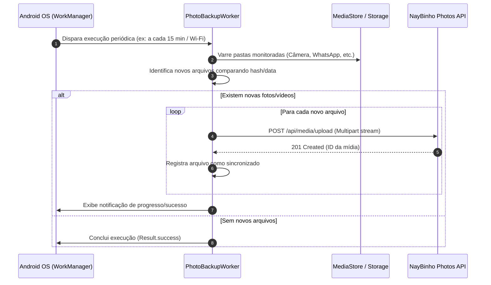

# 📱 Guia do Aplicativo Android & Backup em Segundo Plano

O aplicativo Android do **NayBinho Photos** combina uma interface fluida com serviços nativos em segundo plano para backup contínuo de fotos e vídeos, funcionando de forma transparente mesmo quando o aplicativo é fechado pelo usuário.

---

## 🛠️ Arquitetura do Aplicativo

O app foi desenvolvido em **Kotlin** utilizando as bibliotecas recomendadas pelo **Android Jetpack**:
1. **MainActivity / WebView Imersiva:**
   - Carrega a interface SPA do servidor com aceleração gráfica ativada.
   - Suporte a upload por seletor nativo, acesso à câmera e geolocalização nativa do dispositivo.
   - Comunicação via JavaScript Bridge para notificações, downloads e compartilhamento nativo.
2. **PhotoBackupWorker (`androidx.work.WorkManager`):**
   - Agendamento periódico de tarefas (`PeriodicWorkRequest`) para sincronização em background.
   - Executa mesmo quando o aplicativo é fechado, o aparelho reiniciado ou a tela bloqueada.
3. **Local Store (EncryptedSharedPreferences / DataStore):**
   - Guarda a URL do servidor e o token JWT do usuário de forma segura.

---

## 🔄 Como Funciona o Backup em Segundo Plano



---

## 📂 Pastas Monitoradas no Dispositivo

O worker de sincronização monitora automaticamente as seguintes pastas padrão do armazenamento interno do Android:

| Pasta no Dispositivo | Tipo de Conteúdo |
|---|---|
| `/DCIM/Camera` | Fotos e vídeos tirados pela câmera nativa |
| `/Pictures` | Imagens salvas, prints de tela e fotos de outros apps |
| `/Movies` e `/DCIM` | Vídeos gravados e pastas adicionais de mídia |
| `/Download` | Arquivos de mídia baixados da internet |
| `/Android/media/com.whatsapp/WhatsApp/Media/WhatsApp Images` | Fotos recebidas e enviadas no WhatsApp |
| `/Android/media/com.whatsapp/WhatsApp/Media/WhatsApp Video` | Vídeos recebidos e enviados no WhatsApp |
| `/WhatsApp/Media/WhatsApp Images` *(legado)* | Fotos do WhatsApp em versões anteriores do Android |
| `/WhatsApp/Media/WhatsApp Video` *(legado)* | Vídeos do WhatsApp em versões anteriores do Android |

---

## 📋 Permissões Necessárias (Android Manifest)

Para garantir o funcionamento pleno no Android 7.0 até o Android 14+:

```xml
<!-- Acesso à Rede -->
<uses-permission android:name="android.permission.INTERNET" />
<uses-permission android:name="android.permission.ACCESS_NETWORK_STATE" />

<!-- Notificações em Segundo Plano (Android 13+) -->
<uses-permission android:name="android.permission.POST_NOTIFICATIONS" />

<!-- Acesso a Mídia (Android 13+) -->
<uses-permission android:name="android.permission.READ_MEDIA_IMAGES" />
<uses-permission android:name="android.permission.READ_MEDIA_VIDEO" />

<!-- Armazenamento Legado (Android 12 e anteriores) -->
<uses-permission android:name="android.permission.READ_EXTERNAL_STORAGE" />
<uses-permission android:name="android.permission.WRITE_EXTERNAL_STORAGE" android:maxSdkVersion="28" />

<!-- Inicialização Automática após Reiniciar -->
<uses-permission android:name="android.permission.RECEIVE_BOOT_COMPLETED" />

<!-- Geolocalização (para vincular GPS na foto via câmera do app) -->
<uses-permission android:name="android.permission.ACCESS_FINE_LOCATION" />
<uses-permission android:name="android.permission.ACCESS_COARSE_LOCATION" />
```

---

## 🔨 Como Compilar o Arquivo APK

### Opção 1: Usando o Script PowerShell (Recomendado)
Execute no PowerShell:
```powershell
powershell -ExecutionPolicy Bypass -File c:\Users\Douglas\Documents\Apps\Photos\apk\build_apk.ps1
```
O arquivo APK compilado estará disponível em:
`apk/app/build/outputs/apk/debug/app-debug.apk`

### Opção 2: Pelo Android Studio
1. Abra o **Android Studio**.
2. Abra a pasta `c:\Users\Douglas\Documents\Apps\Photos\apk`.
3. Aguarde o *Gradle Sync* finalizar.
4. No menu superior: **Build > Build Bundle(s) / APK(s) > Build APK(s)**.

---

## 🚀 Publicação & Atualizações Automáticas (Auto-Update)

O servidor do **NayBinho Photos** inclui um sistema de distribuição integrado:
1. Copie o APK gerado para a pasta `atualizacao/`:
   ```powershell
   Copy-Item "apk\app\build\outputs\apk\debug\app-debug.apk" "atualizacao\NayBinho-Photos.apk" -Force
   ```
2. Atualize o arquivo `atualizacao/version.json` incrementando o `versionCode` e `versionName`:
   ```json
   {
     "versionCode": 9,
     "versionName": "1.0.8",
     "notes": "Melhorias no backup em segundo plano e sincronização do WhatsApp.",
     "filename": "NayBinho-Photos.apk",
     "fileSize": 6570636,
     "updatedAt": "2026-10-13T17:00:00.000Z"
   }
   ```
3. O aplicativo Android checa esse endpoint periodicamente e notifica o usuário caso haja uma nova versão disponível para download direto.
