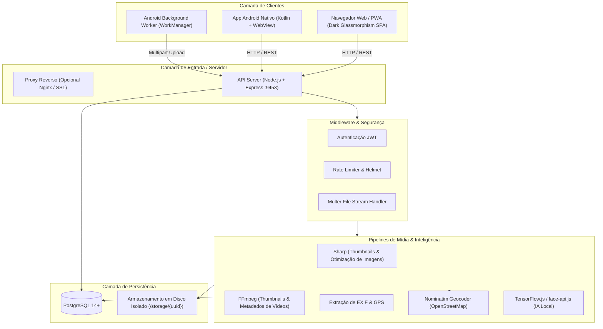
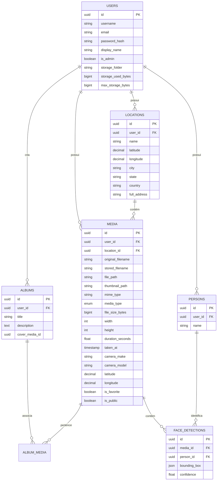

# 🏛️ Arquitetura do NayBinho Photos

Este documento descreve a arquitetura geral do **NayBinho Photos**, abrangendo seus componentes de backend, interface web (frontend), aplicativo móvel Android, processamento de mídia e integração de mapas.

---

## 📐 Visão Geral da Arquitetura

---

## 🧩 Componentes Principais

### 1. Servidor Backend (`src/`)
- **Runtime:** Node.js (CommonJS) sobre Express.
- **ORM:** Sequelize gerenciando PostgreSQL com migrações automáticas de schema (`alter: true` em ambiente seguro).
- **Controle de Mídia:**
  - Extração imediata de dados EXIF (data tirada, câmera, lente, abertura, coordenadas GPS).
  - Geração assíncrona de miniaturas (thumbnails em WebP/JPEG) com `sharp` para imagens e `@ffmpeg-installer/ffmpeg` para vídeos.
  - Streaming eficiente de arquivos com suporte a `Range Requests` (código HTTP `206 Partial Content`), permitindo avançar e retroceder vídeos sem baixar o arquivo inteiro.
- **Geocodificação Reversa (OpenStreetMap):**
  - As coordenadas extraídas das fotos (`latitude` e `longitude`) são consultadas no serviço OpenStreetMap Nominatim com cache local para evitar requisições redundantes e respeitar limites de taxa.
  - Vinculação com o modelo `Location` agrupando fotos do mesmo bairro/cidade.

### 2. Interface Web Frontend (`public/`)
- **Filosofia:** Single Page Application (SPA) construída com Vanilla HTML5, CSS3 moderno (Dark Glassmorphism) e JavaScript ES6+.
- **Desempenho:** Carregamento instantâneo sem frameworks pesados, sem build step obrigatório.
- **Bibliotecas Embutidas:**
  - **Leaflet.js:** Renderização interativa de mapas de calor e marcadores OpenStreetMap com tiles escuros (*CartoDB Dark Matter*) e claros (*OpenStreetMap Standard*).
  - **Lucide Icons:** Biblioteca de ícones SVG limpos e modernos.
- **Resiliência a Falhas:**
  - Monitoramento contínuo de conectividade (`fetch` com timeout).
  - Tela de manutenção automática em caso de queda de servidor, com reconexão reativa sem perda do estado de navegação.

### 3. Aplicativo Móvel Android (`apk/`)
- **Linguagem & Plataforma:** Kotlin nativo, Android SDK 24+ (Android 7.0 até Android 14+).
- **Interface:** Shell nativo com `WebView` imersiva com suporte a aceleração de hardware.
- **Sincronização em Segundo Plano (Background Worker):**
  - Implementado utilizando `androidx.work.WorkManager`.
  - Agendamento periódico (`PeriodicWorkRequest`) com verificação de novas fotos em pastas do sistema.
  - Continua monitorando e fazendo upload de fotos e vídeos mesmo quando o aplicativo é fechado pelo usuário ou o aparelho é reiniciado (`BOOT_COMPLETED`).
  - Suporta pastas da Câmera, Galeria e pastas do WhatsApp (`WhatsApp Images` e `WhatsApp Video`).

---

## 🗄️ Modelo de Dados (PostgreSQL)

---

## 🔒 Princípios de Segurança e Isolamento

1. **Autenticação:** Baseada em tokens JWT criptografados com HMAC-SHA256 e expiração configurável.
2. **Isolamento em Disco:** Cada usuário possui um identificador único (`storage_folder` baseado no seu usuário/UUID). Nenhuma requisição permite navegação de diretórios (`path traversal`) para fora de sua própria pasta.
3. **Senhas Seguras:** Hashing com `bcrypt` com custo de trabalho (salt rounds) 12.
4. **Proteção de Cabeçalhos:** Middleware `helmet` aplicado em todas as rotas HTTP.
5. **Controle de Cota de Disco:** Cada upload decrementa a cota disponível do usuário; ao atingir o limite configurado, novos uploads são rejeitados de forma segura.
